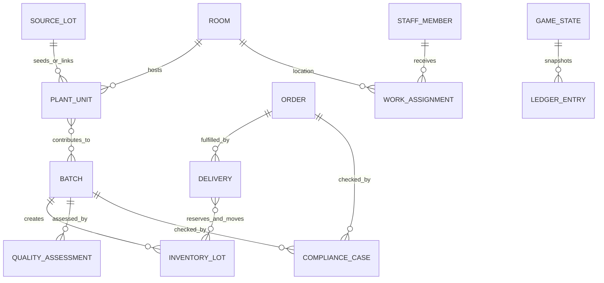

# 04 — Domain Model und Zustandsmaschinen

**Status:** verbindliche Fachspezifikation v1.0.0  
**Zweck:** einheitliche fachliche Wahrheit für Design, Implementierung, Simulation, UI, Saves und Tests.

## 1. Modellierungsregeln

1. Jede fachliche Entität besitzt eine unveränderliche ID.
2. Zustandsänderungen erfolgen ausschließlich über validierte Commands bzw. Domain-Funktionen.
3. Listen und Beziehungen dürfen keine verwaisten Referenzen erzeugen. Jeder Fremdschlüssel muss beim Übergang geprüft werden.
4. Simulationswerte sind abstrakte Spielwerte. Sie sind ausdrücklich keine realen Anbau-, Arzneimittelherstellungs-, Verarbeitungs- oder Vertriebsparameter.
5. Zeitwerte sind Simulationsminuten seit Spielbeginn. Kalenderdatum und lokale Uhrzeit sind Präsentationsdaten, keine fachliche Wahrheit.
6. Geld wird intern als ganzzahliger Cent-Betrag gespeichert. Keine Gleitkomma-Währung.
7. Zufallsereignisse verwenden ausschließlich einen gespeicherten, versionierten Seed und einen zentralen deterministischen RNG.
8. Jeder auditrelevante Übergang schreibt einen append-only Domain-Logeintrag mit Simulationszeit, Actor, Entity, Aktion und Ergebnis.

## 2. Kernentitäten und Beziehungen

- `GameState` ist der serialisierbare Snapshot der gesamten Partie.
- `SourceLot` beschreibt im Spiel angenommene, abstrakte Ausgangsmaterial-Lose; es enthält Herkunftsreferenz, Annahmeprüfung, Menge und Sperrstatus.
- `Room` beschreibt einen Betriebsraum mit Typ, Kapazität, Ausstattung, Sauberkeitsindex, Wartungsindex und Verfügbarkeit.
- `PlantUnit` ist eine fiktionale Produktions-Einheit, die nur abstrakte Wachstums-/Zustandswerte führt.
- `Batch` fasst freigegebene Einheiten oder verarbeitete Bestände zusammen und referenziert Ursprung, Verarbeitungsschritte, QC-Ergebnisse und Bestand.
- `InventoryLot` ist ein mengenführendes Los mit Status, Eigentümerbereich, Haltbarkeit als Spieluhrwert und Batch-Referenz.
- `QualityAssessment` ist ein unveränderlicher Prüfdatensatz mit Regelversion, Score, Findings und Entscheidung.
- `Order` beschreibt Kundenanforderung, Menge, Mindestqualität, Frist, Vertragswert und Status.
- `Delivery` referenziert Auftrag, reservierte Lots, Route, Versand- und Empfangszeit sowie Zustellnachweis.
- `StaffMember` und `WorkAssignment` beschreiben verfügbare Rollen/Kompetenzen und zugewiesene Aufgaben.
- `ComplianceCase`, `AuditRun` und `Violation` halten Regelchecks, Befunde und Maßnahmen fest.
- `LedgerEntry` ist ein unveränderlicher Finanzvorgang; Summen sind abgeleitete Werte.
- `GameEvent` ist ein typisiertes Integrationssignal, kein zweites State-System.

## 3. Zustandsmaschinen

### 3.1 Ausgangslos

`pending_receipt → received → inspected → accepted | quarantined | rejected`

- Kein Plant-/Batch-Start mit `pending_receipt`, `quarantined` oder `rejected`.
- Eine Freigabe verlangt vollständige Pflichtfelder und einen positiven spielinternen Annahmecheck.
- Eine Ablehnung ist terminal; Wiederaufnahme nur über explizit definierten Korrekturvorgang mit neuem Logeintrag.

### 3.2 Produktionseinheit

`planned → active → ready_for_harvest → harvested | rejected`

`harvested` verschiebt die Einheit in die Batch-Erstellung und blockiert weitere Pflegemutationen. Die in diesem Dokument verwendete Lebenszyklus-Mechanik ist eine abstrakte Spielsimulation und enthält keine realen Sorten-, Nährstoff-, Licht-, Klima- oder Zeitrezepte.

### 3.3 Batch und Verarbeitung

`created → queued → processing → awaiting_qc → released | rejected | quarantined`

- `created` verlangt mindestens eine gültige Herkunftsreferenz.
- `processing` verlangt verfügbare Kapazität, vollständige Zuordnung und freigegebene Inputs.
- `awaiting_qc` blockiert Versand und verkaufsfähige Bestandsbuchung.
- `released` ist nur nach erfolgreicher QC und bestandener Compliance-Prüfung erreichbar.
- `rejected` blockiert Verkauf/Versand. Verwerfen oder Rework sind eigene protokollierte Commands mit klaren Regeln; kein stiller Statuswechsel.
- Rework darf niemals die historische QC-Prüfung überschreiben.

### 3.4 Auftrag

`available → accepted → allocated → ready_to_ship → shipped → delivered`

Fehlerpfade: `available → expired`, `accepted|allocated|ready_to_ship → cancelled`, `shipped → delivery_exception`, `allocated → blocked`.

- Annahme prüft Reputation, Kapazität und Vertragsbedingungen.
- Allocation reserviert konkrete freigegebene Bestands-Lose atomar.
- Versand verlangt Menge, Qualität, Traceability, Lizenzstatus und vollständige Dokumentation.
- Lieferung ist idempotent: ein erneuter Empfang desselben Delivery-IDs darf weder Umsatz doppelt buchen noch Bestand erneut abbuchen.

### 3.5 Lizenz-/Compliance-Zustand

`valid ↔ warning → suspended → recovery_review → valid|warning`

Spielinterne Schwellenwerte werden in `src/data/balance.json` als versionierte Spieldaten konfiguriert. Baseline für die erste Balance-Datei: Risiko 0–100; `warning` ab 40, `suspended` ab 80. Suspendierung blockiert alle fachlich als kritisch markierten Transaktionen. Es gibt keinen UI-Bypass.

### 3.6 Save-Sitzung

`clean → dirty → saving → saved` und bei Fehler `saving → save_failed → retry_pending`.

- Simulationsaktionen laufen unabhängig davon weiter, ob eine Speicherung gerade läuft; die Save-Schicht speichert einen konsistenten Snapshot.
- Ein älterer Snapshot darf nie einen neueren erfolgreich geschriebenen Snapshot überschreiben.
- Migrationen laufen vor vollständiger Validierung und vor Übergabe an den Store.

## 4. Invarianten

- Keine freigegebene Lieferung ohne freigegebenen Batch, passende Qualität, vorhandenen Bestand und vollständige Trace-Kette.
- Kein negativer Bestand und keine Reservierung über verfügbare Menge.
- Keine doppelten IDs innerhalb eines Entitätstyps.
- Raumkapazität ist eine positive ganze Zahl; `occupied` bleibt ganzzahlig in `[0, capacity]`.
- Mitarbeiterzuordnung ist bidirektional: `StaffState.assignedRoomId` und `RoomState.assignedStaffIds` müssen übereinstimmen; Rollen-/Raumkompatibilität wird vor jeder Zuweisung geprüft.
- Maschinenzuordnung ist bidirektional: `MachineState.roomId` und `RoomState.assignedMachineIds` müssen übereinstimmen.
- Eine aktive Maschine hat genau einen aktiven Job, und dieser verweist auf einen `processing`-Batch im selben Raum. Maschinen in Wartung sind jobfrei; aktive Maschinen können weder verlegt noch in Wartung gesetzt werden.
- Keine ungültigen Zahlen: alle Scores sind endlich und innerhalb definierter Grenzen.
- Der Tagesabschluss verschiebt die Kampagnenzeit auf 08:00 des Folgetags und bucht Tageslöhne sowie Betriebskosten als unveränderliche Ledger-Einträge.
- Tageskosten werden über den Schlüssel `operating-costs:day:{day}:{wages|utilities}` idempotent gebucht; wiederholte Buchungen desselben Tages dürfen keine doppelten Aufwendungen erzeugen.
- Der Kontostand wird ausschließlich aus Eröffnungsbestand und Ledger abgeleitet. Ein negativer Kontostand bleibt sichtbar und wird nicht stillschweigend auf null begrenzt.
- Prognosen sind reine Spiel-Balance-Szenarien: erwarteter Tagesumsatz ist ein expliziter Parameter und standardmäßig null; die 30-Tage-Anzeige kennzeichnet diese Annahme sichtbar. Projektionen verändern weder Ledger noch Kampagnenzustand.
- Ein Upgrade wird nur bei ausreichendem Kontostand gekauft; die einmalige Investition wird als `investment` im Ledger verbucht und über einen idempotency key gegen Doppelbuchung geschützt. Der Effekt wird ausschließlich aus dem gekauften Upgradezustand abgeleitet.
- Der Finanzstatus wird aus Kontostand und prognostizierter Reichweite abgeleitet; ein kritischer Status darf nicht durch stilles Zurücksetzen des Kontostands verborgen werden.
- Die Krisenhilfe ist nur bei Kontostand `<= 0` verfügbar und darf pro Kampagne höchstens einmal gebucht werden. Der `grant`-Ledger-Eintrag gleicht den Fehlbetrag aus und stellt mindestens sieben Tage der aktuell berechneten Betriebskosten bereit.

- Kein Auftrag wird doppelt erfüllt oder doppelt abgerechnet.
- Kein suspendierter Betrieb führt kritische Freigaben/Versand durch.
- Jeder terminale Übergang hat Ursache, Actor, Simulationszeit und auditrelevanten Logeintrag.
- Der UI-Zustand ist nicht spielentscheidend und wird bei Migration getrennt behandelt.

## 5. Abnahme

Domain-Tests müssen für jeden Übergang mindestens einen positiven Fall, jeden verbotenen Übergang, ungültige Referenzen, Grenzwerte, doppelte Commands, Reihenfolgefehler und Reload-/Migration-Fälle abdecken. Ein Diagramm ohne implementierte, getestete Transitionen gilt nicht als fertig.